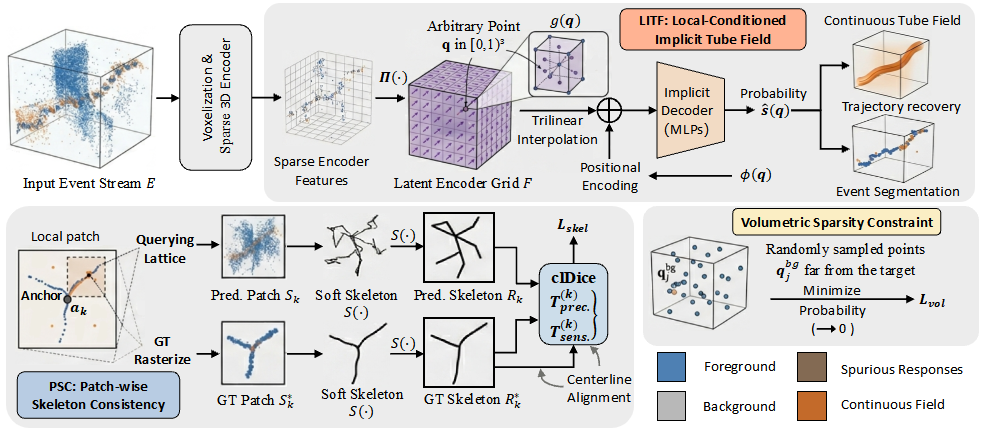

# RidgeField-Net: Continuous Spatio-Temporal Tube Fields for Tiny UAV Detection in Event Streams

This repository provides the implementation of **RidgeField-Net: Continuous Spatio-Temporal Tube Fields for Tiny UAV Detection in Event Streams** on the EV-UAV dataset.

RidgeField-Net models tiny-UAV trajectories as a continuously queryable spatio-temporal tube probability field. The framework combines a sparse 3D encoder with the **Local-Conditioned Implicit Tube Field (LITF)**, **Patch-wise Skeleton Consistency (PSC)**, and volumetric sparsity regularization to recover sparse and fragmented target trajectories while suppressing complex background interference.

For this release, we further optimized several implementation and training details to improve convergence, training stability, and overall segmentation performance. The released checkpoint corresponds to our current optimized configuration.

## Requirements

The released checkpoint and scripts were verified with:

* Python 3.8.20
* PyTorch 1.9.1+cu111
* CUDA runtime 11.1
* cuDNN 8.0.5
* `spconv-cu113` 2.3.6
* `cumm-cu113` 0.4.11
* NumPy 1.24.1
* SciPy 1.10.1
* PyYAML 6.0.2

The experiments were tested on NVIDIA RTX 3090 GPUs.

`spconv` wheels are sensitive to the installed CUDA and PyTorch versions. We recommend using the versions listed above or another known-compatible combination.

## Installation

```bash
conda create -n ridgefield-net python=3.8
conda activate ridgefield-net
pip install -r requirements.txt
```

## Dataset

EV-UAV data are not included in this repository. Download or prepare the EV-UAV dataset and preserve the official train/validation/test split.

The expected directory structure is:

```text
<EV-UAV-root>/
├── train/
│   └── *.npz
├── val/
│   └── *.npz
└── test/
    └── *.npz
```

Each `.npz` archive should contain `evs_norm` and `ev_loc` following the EV-UAV data format used by the training and evaluation pipeline.

The default configuration uses:

```text
./datasets/EV-UAV
```

You can either modify `data.root` in:

```text
configs/ridgefield_ev_uav.yaml
```

or specify the dataset path through `--data-root`.

## Training

Single-GPU training:

```bash
CUDA_VISIBLE_DEVICES=0 python train_ridgefield.py \
  --config configs/ridgefield_ev_uav.yaml \
  --data-root /path/to/EV-UAV
```

Two-GPU training:

```bash
CUDA_VISIBLE_DEVICES=0,1 NCCL_P2P_DISABLE=1 \
python -m torch.distributed.launch \
  --nproc_per_node=2 \
  --use_env \
  train_ridgefield.py \
  --config configs/ridgefield_ev_uav.yaml \
  --data-root /path/to/EV-UAV
```

The code supports both single-GPU and distributed multi-GPU training. Two-GPU training is recommended when available to reduce training time.

## Evaluation

The released checkpoint is:

```text
checkpoints/ridgefield_net_ev_uav_best.pth
```

Run evaluation with:

```bash
CUDA_VISIBLE_DEVICES=0 python eval_ridgefield.py \
  --config configs/ridgefield_ev_uav.yaml \
  --checkpoint checkpoints/ridgefield_net_ev_uav_best.pth \
  --data-root /path/to/EV-UAV \
  --split test
```

Use `--no-save` to print the evaluation results without writing a JSON result file.

The released evaluation configuration uses:

* Event-level foreground threshold: `τ = 0.9`
* Pd temporal slice length: `50 ms`
* Pd coverage threshold: `η = 1e-4`
* Structural metric grid: `96 × 72 × 48`
* One-step dilation before structural skeletonization
* 3D soft-skeletonization for `clDice` and `Frag`

## Results


Evaluation on the **24-sequence EV-UAV test split** gives:

| Metric       |    Result |
| ------------ | --------: |
| IoU (%) ↑    | **76.59** |
| Dice (%) ↑   | **86.74** |
| clDice (%) ↑ | **87.90** |
| Pd (%) ↑     | **89.51** |
| Fa (×10⁻⁴) ↓ | **0.201** |
| Frag ↓       | **1.048** |

We further optimized several implementation and training details, including optimization strategy, training stability, and model configuration, while preserving the core RidgeField-Net framework consisting of the sparse 3D encoder, LITF, PSC, and volumetric sparsity regularization.


Small numerical variations may occur with different GPUs, CUDA versions, sparse-convolution builds, or random seeds.

## Acknowledgements

We thank the authors of [EV-SpSegNet](https://github.com/ChenYichen9527/Ev-UAV) for open-sourcing their code and the EV-UAV benchmark, which provide a valuable foundation for event-based tiny-UAV research.
